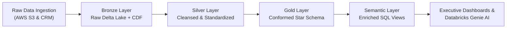
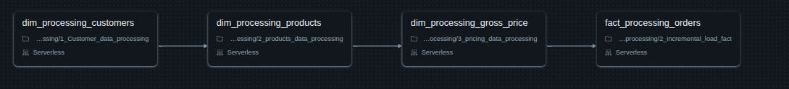
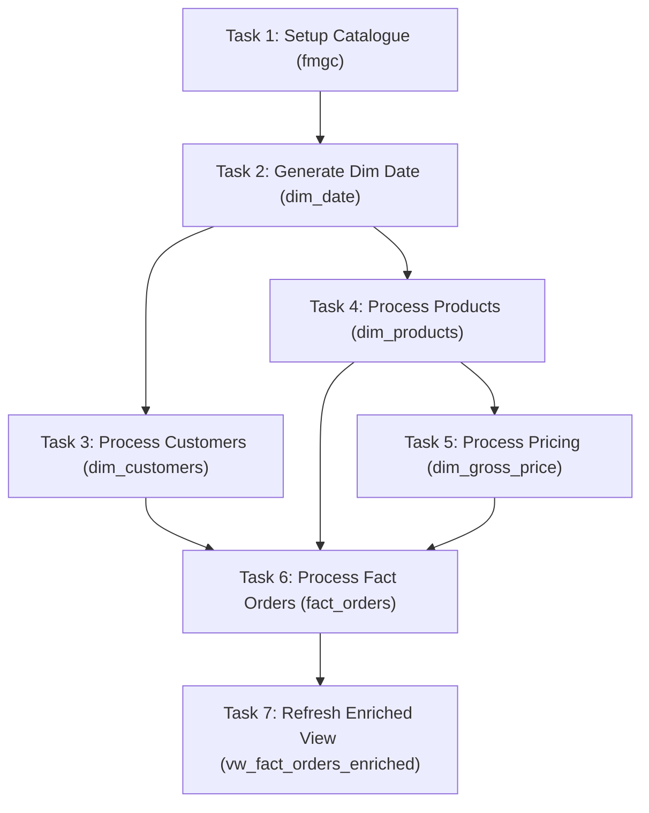
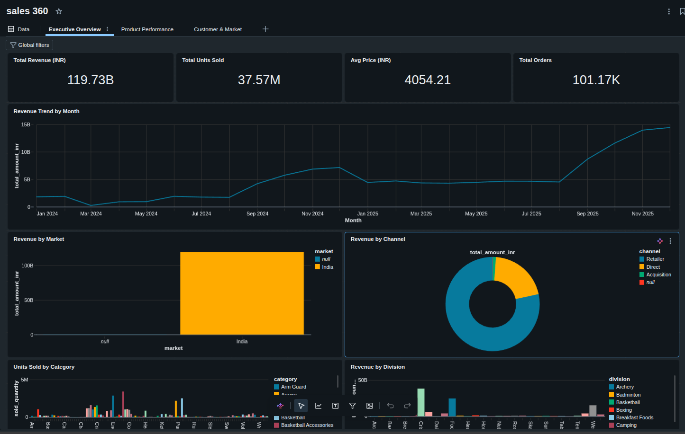
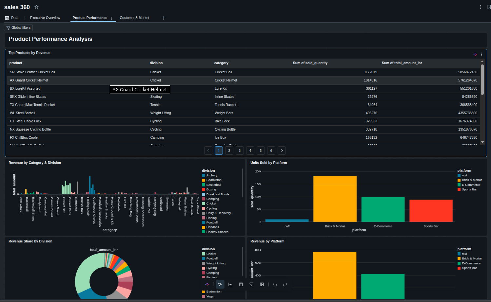
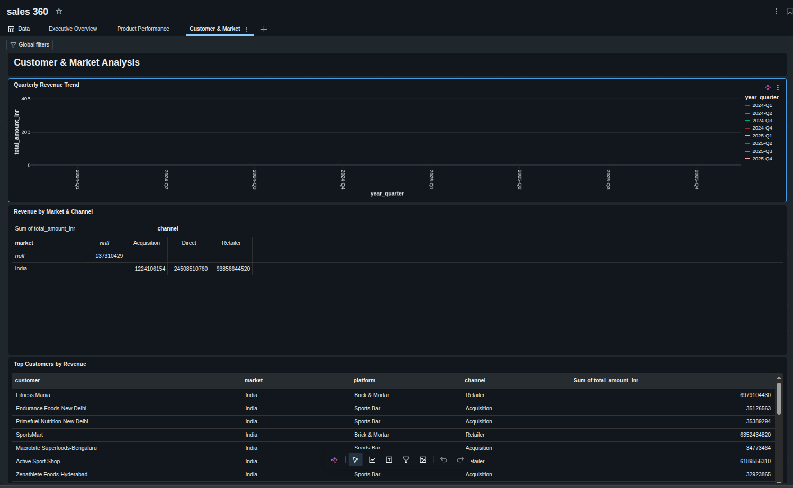

# 🏅 Enterprise Lakehouse ETL & Data Consolidation Pipeline
### Harmonizing Enterprise ERP & High-Growth Startup Data on Databricks Delta Lake


---

## 📖 Executive Summary

This project showcases an enterprise-grade data engineering architecture designed to consolidate data following the strategic acquisition of **Child Company (abc)** (a fast-growing sports nutrition startup) by **Parent Company (ABC)** (a large, established sports equipment manufacturer).

By building an automated **Medallion Lakehouse Architecture** on **Databricks Delta Lake**, this solution resolves extreme source data heterogeneity, multi-format date inconsistencies, dirty data anomalies, negative prices, and grain mismatches (daily transactional orders vs. monthly enterprise financial grain), delivering a conformed **Star Schema** and unified **Executive BI Reporting Views**.



---

## 📂 Recruiter Documentation Suite

All detailed architectural, data quality, ETL, and business reports are structured inside the [`docs/`](docs) folder with direct clickable links below:

| # | Document | Description | Key Focus & Deliverables |
|:---:|:---|:---|:---|
| 📄 **01** | [**PRD (Project Requirements Document)**](docs/01_PROJECT_REQUIREMENTS_DOCUMENT_PRD.md) | Business problem statement, M&A context, Lakehouse objectives, success criteria, and deliverables matrix. | Business requirements, scope, milestones |
| 🏛️ **02** | [**Data Model & Schema Catalog**](docs/02_DATA_MODEL_AND_SCHEMA_CATALOG.md) | Conformed Star Schema, Databricks catalog hierarchy (`fmgc`), and field-by-field Parent vs. Child mappings. | Mermaid ER diagrams, DDL scripts, schema tables |
| 🛠️ **03** | [**Parent vs. Child Mismatch & Resolution Playbook**](docs/03_PARENT_CHILD_TABLES_AND_MISMATCH_RESOLUTION.md) | **Deep-Dive Interview Playbook**: Side-by-side table schemas, raw sample data, anomaly matrices, and PySpark handling code for all 4 entities. | Raw table samples, mismatch audits, PySpark solutions |
| 🔍 **03b** | [**Data Quality & Mismatch Report**](docs/03_DATA_QUALITY_AND_MISMATCH_REPORT.md) | Comprehensive anomaly audit across Customers, Products, Pricing, and Orders (typos, negative prices, date formats, nulls). | Anomaly severity matrix, root cause analysis |
| ⚙️ **04** | [**Pipeline Engineering & ETL Design**](docs/04_PIPELINE_ENGINEERING_AND_ETL_DESIGN.md) | Technical implementation of PySpark transformations, SHA-256 surrogate keys, Delta MERGE, Full & Incremental loads. | PySpark scripts, Window ranking, DAG workflows |
| 📊 **05** | [**Analytics & BI Dashboard Guide**](docs/05_ANALYTICS_AND_BI_DASHBOARD_GUIDE.md) | Semantic view (`vw_fact_orders_enriched`), KPI formulations, Executive, Product, and Market dashboards. | SQL views, dashboard screenshots, Genie prompts |

---

## 🏗️ Architecture & Orchestration

### End-to-End System Architecture


### Automated Pipeline Orchestration DAG




---

## 🛠️ Key Technical Highlights & Engineering Challenges

1. **Deterministic Surrogate Key Generation**:
   - Resolved child product entity identification gaps by generating collision-resistant SHA-256 hashes (`F.sha2(product_name, 256)`) to ensure deterministic 1:1 conformance with parent dimensions.
2. **Multi-Format Date Normalization**:
   - Engineered robust parsing logic handling 4+ concurrent date conventions including natural language day prefixes (`"Tuesday, July 01, 2025"`, `dd-MM-yyyy`, `yyyy/MM/dd`) using chained `F.coalesce(F.try_to_date(...))`.
3. **Dynamic Temporal Grain Harmonization**:
   - Seamlessly rolled up child daily order transactions to parent monthly accounting grain (`YYYY-MM-01`) using `F.trunc("date", "MM")` and partition-aware recalculations in incremental pipelines.
4. **Idempotent Delta Lake Upserts**:
   - Implemented `DeltaTable.merge()` across all dimensional and fact pipelines, guaranteeing idempotent backfills and zero duplicate records across reruns.
5. **Annual Pricing Window Ranking**:
   - Reconciled monthly fluctuating startup prices into annual enterprise catalog prices using PySpark Window functions (`partitionBy("product_code", "year").orderBy(is_zero, month.desc())`).

---

## 📊 Analytics & Dashboards Preview

| Executive Overview | Product Performance | Customer & Market Insights |
| :---: | :---: | :---: |
| [](docs/05_ANALYTICS_AND_BI_DASHBOARD_GUIDE.md#31-executive-overview-dashboard) | [](docs/05_ANALYTICS_AND_BI_DASHBOARD_GUIDE.md#32-product-performance-analysis-dashboard) | [](docs/05_ANALYTICS_AND_BI_DASHBOARD_GUIDE.md#33-customer--market-analysis-dashboard) |

---

## 🚀 Repository Structure & Direct Navigation

```
.
├── 0_data/                                  # Raw Source Feeds (Parent ERP & Child S3 extracts)
│   ├── 1_parent_company/                    # Legacy ERP CSV extracts (monthly grain)
│   └── 2_child_company/                     # Startup daily landing & full load extracts
├── consolidated_pipeline/                   # Databricks PySpark Production Notebooks
│   └── consolidated_pipeline/
│       ├── setup/                           # Catalog & Date Dimension setup scripts
│       ├── 2_dim_data_processing/           # Dimension ETLs (Customers, Products, Pricing)
│       └── 3_Fact_data_processing/          # Fact ETLs (Full Load & Incremental Load)
├── dashboard_view/                          # BI Dashboard screenshots & SQL Semantic View
├── docs/                                    # Comprehensive Documentation Suite
│   ├── 01_PROJECT_REQUIREMENTS_DOCUMENT_PRD.md
│   ├── 02_DATA_MODEL_AND_SCHEMA_CATALOG.md
│   ├── 03_PARENT_CHILD_TABLES_AND_MISMATCH_RESOLUTION.md
│   ├── 03_DATA_QUALITY_AND_MISMATCH_REPORT.md
│   ├── 04_PIPELINE_ENGINEERING_AND_ETL_DESIGN.md
│   └── 05_ANALYTICS_AND_BI_DASHBOARD_GUIDE.md
├── resources/                               # Excalidraw diagrams & Architecture PNGs
├── job_pipeline.png                         # Databricks Workflow execution screenshot
└── README.md                                # Master Project Portfolio Home
```
