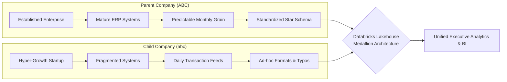
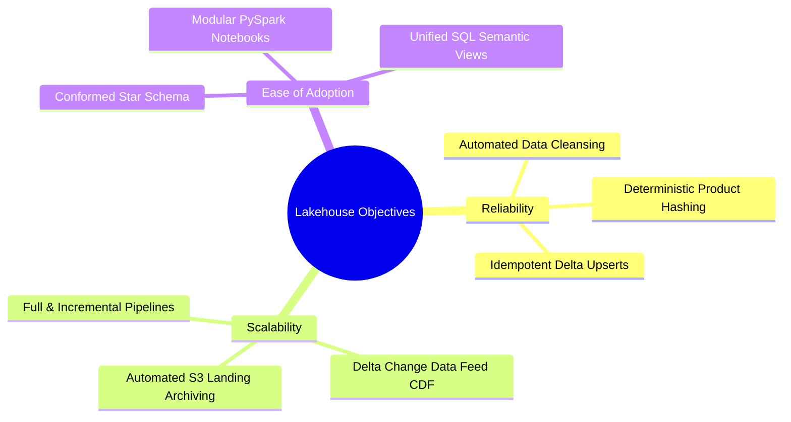
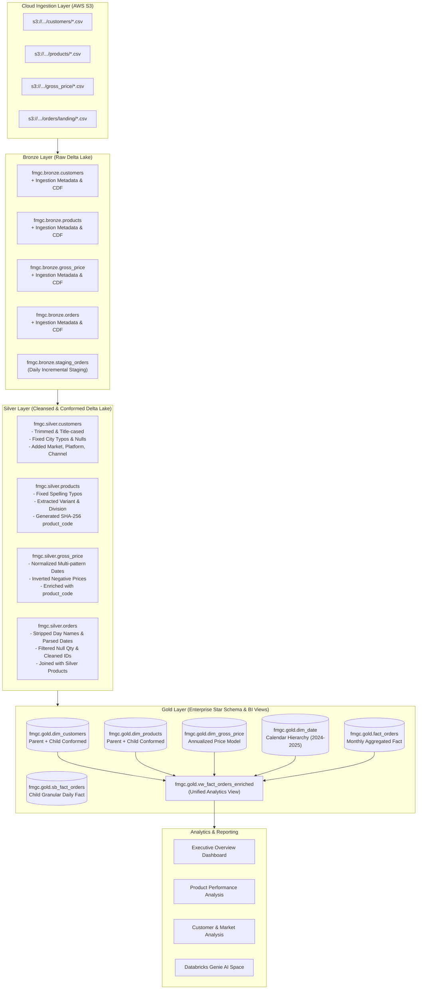
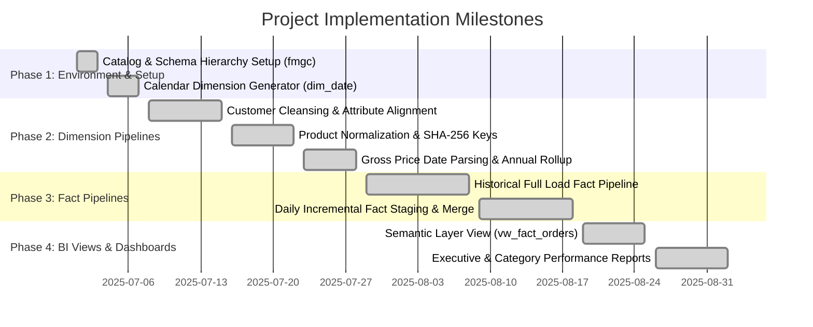

# 📋 Project Requirements Document (PRD)
## Enterprise Lakehouse Data Integration: Parent Company (ABC) × Child Company (abc)

---

### 1. Executive Summary & Business Context

**Parent Company (ABC)** is a large, established sports equipment manufacturer operating with mature, predictable, and structured Enterprise Resource Planning (ERP) systems. Its analytical workflows rely on standardized relational databases, consistent monthly financial accounting cycles, rigid dimensional schemas, and established data governance frameworks.

To accelerate market expansion into the high-growth sports nutrition and health segment, Parent Company (ABC) acquired **Child Company (abc)**, a fast-growing startup. While Child Company (abc) brings high operational agility and rapid market adoption, it operates with fragmented, decentralized data sources—including spreadsheets, Cloud/S3 landing buckets, WhatsApp exports, and ad-hoc extracts.

#### Problem Statement
The core business challenge is to consolidate the data from both companies to provide unified, reliable, and scalable analytics while retaining Child Company (abc)'s unique operational culture and fast-paced workflows:
- **Heterogeneous Sources**: Child Company data originates from disparate transactional CSV files uploaded to AWS S3 storage.
- **Inconsistent Date Conventions**: Raw files contain conflicting date representations (`yyyy/MM/dd`, `dd-MM-yyyy`, `"Tuesday, July 01, 2025"`).
- **Data Quality Anomalies**: Presence of city typos (`Bengaluruu`, `Bengalore`), negative prices (`-84`), unmapped text values (`unknown`), missing foreign keys, and alphanumeric corrupted IDs (`XYZ123`).
- **Granularity Mismatch**: Child Company transactions occur at the **daily individual order line level**, whereas Parent Company reporting operates on a **monthly aggregated grain** (`YYYY-MM-01`).

---

### 2. Project Objectives & Success Criteria

| Dimension | Target Requirement | Business Impact |
| :--- | :--- | :--- |
| **Reliability** | Provide accurate, consolidated analytics in a single unified dashboard without data loss or corruption. | Prevents revenue distortions from negative prices, duplicate orders, or dropped unmapped records. |
| **Scalability** | The Lakehouse architecture must handle future data volume growth seamlessly, even if complete legacy system integration takes longer than the planned timeline. | Dual-mode pipeline (historical full load + automated daily incremental staging) scales to high-volume feeds. |
| **Ease of Adoption** | The pipeline and data model must be intuitive and modular for future data team hires, keeping the learning curve manageable. | Standard Medallion layers, clean PySpark modules, and conformed Star Schema enable rapid onboarding. |
| **Schema Harmonization** | Seamlessly map and merge Child Company entities into Parent Company conformed dimensions (`dim_customers`, `dim_products`, `dim_gross_price`, `dim_date`, `fact_orders`). | Enables enterprise-wide cross-company reporting without modifying Parent Company legacy structures. |
| **Temporal Granularity** | Aggregate daily transactional sales into monthly conformed sales records aligned with the Parent Company accounting calendar. | Ensures consistent month-over-month revenue tracking across both organizations. |

---

### 3. Technical Architecture & Tech Stack

The solution implements the **Medallion Lakehouse Architecture** on Databricks Delta Lake, leveraging distributed Apache Spark processing and AWS Cloud Storage.

#### Technology Stack Specifications
- **Platform**: Databricks (Free / Community / Workspace Edition)
- **Architecture**: Medallion Architecture (Bronze $\rightarrow$ Silver $\rightarrow$ Gold layers)
- **Core Stack**: Python (PySpark 3.5+), Spark SQL, Delta Lake, AWS S3
- **Table Storage**: Delta Lake format with Change Data Feed enabled (`delta.enableChangeDataFeed = true`)
- **Data Governance**: Databricks Three-Level Namespace (`fmgc.bronze`, `fmgc.silver`, `fmgc.gold`)
- **Reporting & AI**: Databricks BI Dashboards, SQL Semantic Views, and Databricks Genie for AI-assisted conversational querying

---

### 4. Key Deliverables & Scope Matrix

1. **Consolidated Pipeline (Full & Incremental)**:
   - **Full Load Pipeline** (`1_full_load_fact.py`): Ingests historical batch files, moves landing files to `processed/`, aggregates daily transactions to monthly grain, and merges into `fmgc.gold.fact_orders`.
   - **Incremental Load Pipeline** (`2_incremental_load_fact.py`): Uses staging tables for newly arrived daily batches, isolates impacted monthly partitions, recalculates affected monthly aggregates from `sb_fact_orders`, and executes an idempotent `DeltaTable.merge()`.
2. **Conformed Star Schema Data Model**:
   - `dim_customers`: Conforms Child Company retail partners with Parent Company customer codes and attributes.
   - `dim_products`: Normalizes categories, extracts variants, maps divisions, and generates deterministic SHA-256 `product_code`.
   - `dim_gross_price`: Resolves multi-format dates, inverts negative prices, and aggregates to annual list prices using window ranking.
   - `dim_date`: Calendar dimension with monthly surrogate keys (`yyyyMM`), quarters, and month names.
   - `fact_orders`: Monthly grain enterprise fact table (`date`, `product_code`, `customer_code`, `sold_quantity`).
   - `sb_fact_orders`: Child daily operational fact table (`order_id`, `date`, `customer_code`, `product_code`, `sold_quantity`).
3. **BI Dashboards & Semantic Reporting Layer**:
   - `vw_fact_orders_enriched`: Denormalized SQL view computing derived revenue metrics (`sold_quantity * price_inr`).
   - Dashboards: Executive Overview, Product Performance Analysis, Customer & Market Analysis, and Databricks Genie AI querying space.
