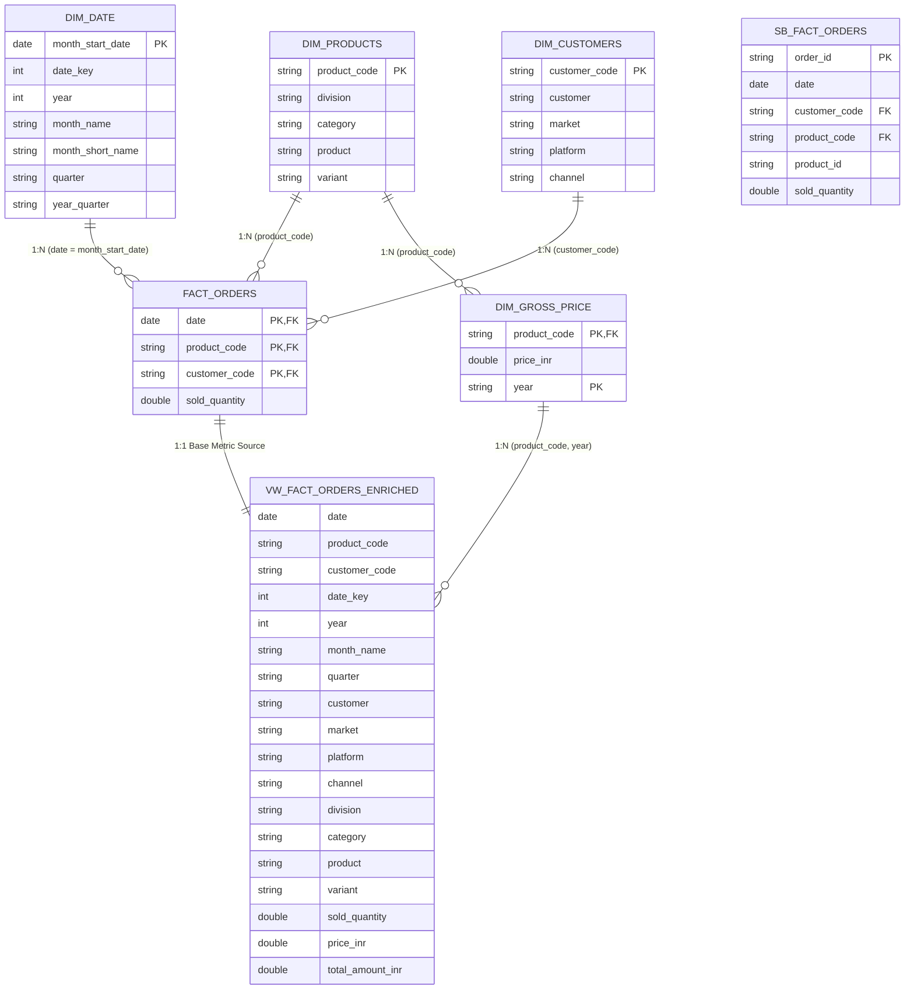

# 🏛️ Data Model & Schema Catalog
## Enterprise Lakehouse Architecture & Conformed Star Schema

---

### 1. Enterprise Star Schema Architecture

The enterprise analytical layer is modeled as an optimized **Star Schema** within the `fmgc.gold` schema on Databricks Delta Lake. This architecture integrates legacy **Parent Company (ABC)** ERP data and acquired **Child Company (abc)** transactional data into a single source of truth, enabling high-performance aggregations across customer, product, pricing, and temporal dimensions.



---

### 2. Databricks Catalog Hierarchy (`fmgc`)

The Lakehouse enforces a **Three-Level Namespace** (`catalog.schema.table`) on Databricks Delta Lake:

```mermaid
graph TD
    Catalog["Catalog: fmgc"] --> Bronze["Schema: bronze (Raw Ingestion Layer)"]
    Catalog --> Silver["Schema: silver (Cleansed & Conformed Layer)"]
    Catalog --> Gold["Schema: gold (Analytical Star Schema Layer)"]

    Bronze --> B_Cust["fmgc.bronze.customers"]
    Bronze --> B_Prod["fmgc.bronze.products"]
    Bronze --> B_Price["fmgc.bronze.gross_price"]
    Bronze --> B_Ord["fmgc.bronze.orders"]
    Bronze --> B_Stg["fmgc.bronze.staging_orders"]

    Silver --> S_Cust["fmgc.silver.customers"]
    Silver --> S_Prod["fmgc.silver.products"]
    Silver --> S_Price["fmgc.silver.gross_price"]
    Silver --> S_Ord["fmgc.silver.orders"]
    Silver --> S_Stg["fmgc.silver.staging_orders"]

    Gold --> G_Cust["fmgc.gold.dim_customers"]
    Gold --> G_Prod["fmgc.gold.dim_products"]
    Gold --> G_Price["fmgc.gold.dim_gross_price"]
    Gold --> G_Date["fmgc.gold.dim_date"]
    Gold --> G_Fact["fmgc.gold.fact_orders"]
    Gold --> G_SBFact["fmgc.gold.sb_fact_orders"]
    Gold --> G_View["fmgc.gold.vw_fact_orders_enriched"]
```



---

### 3. Source Schema Specifications: Parent Company (ABC) vs Child Company (abc)

#### 3.1 Customer Entity Comparison

| Attribute | Parent Company (ABC) ERP (`dim_customers.csv`) | Child Company (abc) Raw Feed (`customers.csv`) | Conformed Gold Model (`fmgc.gold.dim_customers`) | Transformations Applied |
| :--- | :--- | :--- | :--- | :--- |
| **Identifier** | `customer_code` (STRING, e.g., `70002017`) | `customer_id` (INT, e.g., `789201`) | `customer_code` (STRING) | Cast numerical IDs to string to conform with the Parent Star Schema primary key. |
| **Customer Name** | `customer` (STRING, e.g., `Sporty Essentials`) | `customer_name` (STRING, e.g., ` FitFuel Market `) | `customer` (STRING, e.g., `Fitfuel Market-Bengaluru`) | Trimmed whitespace, title-cased (`initcap`), and merged with city: `concat_ws("-", customer_name, city)`. |
| **Geography** | `market` (STRING, e.g., `India`) | `city` (STRING, e.g., `Bengaluruu`) | `market` (STRING, defaulted to `India`) | City typos corrected (`Bengaluruu` $\rightarrow$ `Bengaluru`); country initialized to `India`. |
| **Business Platform** | `platform` (STRING, e.g., `Brick & Mortar`, `E-Commerce`) | *Not present* | `platform` (STRING, set to `Sports Bar`) | Business identifier assigned in ETL pipeline to tag the acquired subsidiary brand. |
| **Channel** | `channel` (STRING, e.g., `Retailer`, `Direct`) | *Not present* | `channel` (STRING, set to `Acquisition`) | Tagged as `Acquisition` to enable executive tracking of M&A synergy performance. |

---

#### 3.2 Product Entity Comparison

| Attribute | Parent Company (ABC) ERP (`dim_products.csv`) | Child Company (abc) Raw Feed (`products.csv`) | Conformed Gold Model (`fmgc.gold.dim_products`) | Transformations Applied |
| :--- | :--- | :--- | :--- | :--- |
| **Primary Code** | `product_code` (STRING, e.g., `ARCHDDE20D`) | *Not present* | `product_code` (STRING, SHA-256 Hash) | Deterministic SHA-256 hash computed from `product_name` via `F.sha2(product_name, 256)`. |
| **Legacy ID** | *Not present* | `product_id` (INT/STRING, e.g., `25891101`, `XYZ123`) | `product_id` (Retained in Silver & Child Gold) | Filtered via numeric regex; non-numeric values sanitized with fallback `999999`. |
| **Product Name** | `product` (STRING, e.g., `PX Carbon Arrow Set`) | `product_name` (STRING, e.g., `SportsBar Protien Bar (45g)`) | `product` (STRING) | Repaired typo (`Protien` $\rightarrow$ `Protein`) using `regexp_replace`. |
| **Division** | `division` (STRING, e.g., `Archery`, `Badminton`) | *Not present* | `division` (STRING) | Conditionally mapped from category (`Nutrition Bars`, `Breakfast Foods`, `Dairy & Recovery`, etc.). |
| **Category** | `category` (STRING, e.g., `Arrows`, `Bow`) | `category` (STRING, e.g., `energy bars`) | `category` (STRING) | Normalized casing via `initcap` and corrected spelling (`Protein`). |
| **Variant** | `variant` (STRING, e.g., `12 Pack`, `26 lbs`) | *Embedded in product_name* | `variant` (STRING, e.g., `45g`, `30 Sachets`) | Extracted parenthesized unit tokens using regex `r"\((.*?)\)"`. |

---

#### 3.3 Pricing Entity Comparison

| Attribute | Parent Company (ABC) ERP (`dim_gross_price.csv`) | Child Company (abc) Raw Feed (`gross_price.csv`) | Conformed Gold Model (`fmgc.gold.dim_gross_price`) | Transformations Applied |
| :--- | :--- | :--- | :--- | :--- |
| **Product Link** | `product_code` (STRING) | `product_id` (INT) | `product_code` (STRING) | Joined with `fmgc.silver.products` on `product_id` to attach conformed `product_code`. |
| **Time Grain** | `year` (STRING, e.g., `2024`) | `month` (STRING, multi-format dates) | `year` (STRING) | Parsed multi-pattern dates to `YYYY-MM-DD`, then extracted `year` via Window ranking. |
| **Price Metric** | `price_inr` (DOUBLE, e.g., `2750`) | `gross_price` (STRING/DOUBLE, e.g., `-84`, `unknown`) | `price_inr` (DOUBLE) | Negatives inverted to positive (`abs`), non-numerics mapped to `0`. Window ranking selects latest valid price per year. |

---

#### 3.4 Sales Orders Fact Comparison

| Attribute | Parent Company (ABC) ERP (`fact_orders.csv`) | Child Company (abc) Raw Feed (`orders/landing/*.csv`) | Conformed Gold Fact (`fact_orders` / `sb_fact_orders`) | Transformations Applied |
| :--- | :--- | :--- | :--- | :--- |
| **Transaction ID** | *Not present (Pre-aggregated)* | `order_id` (STRING, e.g., `FJUL33320501`) | Preserved in `sb_fact_orders`, omitted from monthly `fact_orders` | Retained in granular child fact table for operational analysis; rolled up for enterprise fact. |
| **Date Grain** | `date` (DATE, e.g., `2024-01-01` - Month 1st) | `order_placement_date` (STRING, daily timestamps) | `date` (DATE, `YYYY-MM-01` first of month) | Stripped day-of-week strings, parsed dates, and truncated to monthly grain via `F.trunc("date", "MM")`. |
| **Customer Link** | `customer_code` (STRING) | `customer_id` (INT/STRING) | `customer_code` (STRING) | Cleaned to numeric string; fallback `999999` for corrupt IDs. |
| **Product Link** | `product_code` (STRING) | `product_id` (INT) | `product_code` (STRING) | Joined with Silver Products using `product_id` to attach conformed `product_code`. |
| **Quantity Metric**| `sold_quantity` (DOUBLE) | `order_qty` (DOUBLE, e.g., `150.0`, nulls) | `sold_quantity` (DOUBLE) | Filtered nulls and aggregated total sold volume at `(month_start, product_code, customer_code)`. |

---

### 4. Table DDL & Schema Definitions

```sql
-- 1. Date Dimension Table
CREATE OR REPLACE TABLE fmgc.gold.dim_date (
    month_start_date DATE NOT NULL,
    date_key INT NOT NULL,
    year INT NOT NULL,
    month_name STRING NOT NULL,
    month_short_name STRING NOT NULL,
    quarter STRING NOT NULL,
    year_quarter STRING NOT NULL
) USING DELTA;

-- 2. Conformed Customer Dimension Table
CREATE OR REPLACE TABLE fmgc.gold.dim_customers (
    customer_code STRING NOT NULL,
    customer STRING NOT NULL,
    market STRING NOT NULL,
    platform STRING NOT NULL,
    channel STRING NOT NULL
) USING DELTA
TBLPROPERTIES (delta.enableChangeDataFeed = true);

-- 3. Conformed Product Dimension Table
CREATE OR REPLACE TABLE fmgc.gold.dim_products (
    product_code STRING NOT NULL,
    division STRING NOT NULL,
    category STRING NOT NULL,
    product STRING NOT NULL,
    variant STRING
) USING DELTA
TBLPROPERTIES (delta.enableChangeDataFeed = true);

-- 4. Conformed Annual Gross Price Dimension
CREATE OR REPLACE TABLE fmgc.gold.dim_gross_price (
    product_code STRING NOT NULL,
    price_inr DOUBLE NOT NULL,
    year STRING NOT NULL
) USING DELTA
TBLPROPERTIES (delta.enableChangeDataFeed = true);

-- 5. Child Granular Orders Fact (Daily Operational Grain)
CREATE OR REPLACE TABLE fmgc.gold.sb_fact_orders (
    order_id STRING NOT NULL,
    date DATE NOT NULL,
    customer_code STRING NOT NULL,
    product_code STRING NOT NULL,
    product_id STRING,
    sold_quantity DOUBLE NOT NULL
) USING DELTA
TBLPROPERTIES (delta.enableChangeDataFeed = true);

-- 6. Enterprise Monthly Aggregated Fact (Strategic Financial Grain)
CREATE OR REPLACE TABLE fmgc.gold.fact_orders (
    date DATE NOT NULL,
    product_code STRING NOT NULL,
    customer_code STRING NOT NULL,
    sold_quantity DOUBLE NOT NULL
) USING DELTA
TBLPROPERTIES (delta.enableChangeDataFeed = true);
```
