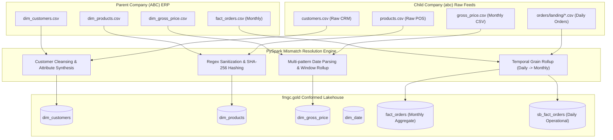

# 🛠️ Parent vs. Child Tables & Mismatch Resolution Playbook
## End-to-End Schema Mapping, Anomaly Audits, & PySpark Handling Logic

---

### 1. Architectural Overview

To achieve seamless data consolidation on the Databricks Lakehouse, we harmonized disparate operational datasets from **Parent Company (ABC)** (mature ERP system) and **Child Company (abc)** (fast-growing startup).



---

### 2. Customer Entity: Parent vs. Child Deep Dive

#### 2.1 Raw Table Schemas & Data Samples

##### Parent Company (ABC) Table: `dim_customers.csv`
```csv
customer_code,customer,market,platform,channel
70002017,Sporty Essentials,India,Brick & Mortar,Retailer
70002018,PlayMore Sports,India,Brick & Mortar,Retailer
90002001,SportsHub,India,E-Commerce,Retailer
```

##### Child Company (abc) Table: `customers.csv`
```csv
customer_id,customer_name,city
789201,FitFuel Market,Bengaluru
789121, HydroBoost Nutrition ,Hyderabad
789403,SprintX Nutrition,
789420, ZenAthlete foods ,
789421, ZenAthlete Foods ,Hyderbad
789422,ZenAthlete Foods,NewDelhee
789520,PrimeFuel Nutrition,Bengaluruu
```

---

#### 2.2 Customer Mismatch Audit & Resolution Matrix

| # | Mismatch / Anomaly | Source Evidence | Impact | PySpark Resolution Strategy |
|---|---|---|---|---|
| **1** | **Primary Key Type & Name** | Parent has `customer_code` (STRING); Child has `customer_id` (INT) | Failed schema matching during Delta MERGE | Cast `customer_id` to STRING and alias as `customer_code`. |
| **2** | **Whitespace & Casing** | `' HydroBoost Nutrition '`, `' ZenAthlete foods '` | Duplicate dimension entries; dirty strings | Applied `F.trim()` and `F.initcap()`. |
| **3** | **City Spelling Errors** | `'Bengaluruu'`, `'Bengalore'`, `'Hyderabadd'`, `'Hyderbad'`, `'NewDelhee'`, `'NewDheli'` | Fragmented geographic sales analytics | Standardized via dictionary replacement mapping to `['Bengaluru', 'Hyderabad', 'New Delhi']`. |
| **4** | **Missing / Null Cities** | `customer_id` in `[789403, 789420, 789521, 789603]` have empty `city` values | Broken geographic hierarchy | Business lookup table (`df_fix`) left-joined to impute exact verified cities via `F.coalesce()`. |
| **5** | **Missing Schema Attributes** | Child lacks `market`, `platform`, `channel`, and combined `customer` column | Missing dimensions required by Parent Star Schema | Derived composite name `concat_ws("-", customer_name, city)`, set `market="India"`, `platform="Sports Bar"`, `channel="Acquisition"`. |

---

#### 2.3 PySpark Transformation Code (`1_Customer_data_processing.py`)

```python
# 1. Deduplication, Trimming & Casing
df_silver = (
    df_bronze
    .dropDuplicates(["customer_id"])
    .withColumn("customer_name", F.initcap(F.trim(F.col("customer_name"))))
)

# 2. City Typo Correction Mapping
city_mapping = {
    'Bengaluruu': 'Bengaluru', 'Bengalore': 'Bengaluru',
    'Hyderabadd': 'Hyderabad', 'Hyderbad': 'Hyderabad',
    'NewDelhi': 'New Delhi',   'NewDheli': 'New Delhi', 'NewDelhee': 'New Delhi'
}
allowed = ["Bengaluru", "Hyderabad", "New Delhi"]

df_silver = (
    df_silver
    .replace(city_mapping, subset=["city"])
    .withColumn("city", F.when(F.col("city").isin(allowed), F.col("city")).otherwise(None))
)

# 3. Impute Missing Cities via Business Lookup Join
customer_city_fix = {
    789403: "New Delhi",  # SprintX Nutrition
    789420: "Bengaluru",  # ZenAthlete Foods
    789521: "Hyderabad",  # PrimeFuel Nutrition
    789603: "Hyderabad"   # Recovery Lane
}
df_fix = spark.createDataFrame([(k, v) for k, v in customer_city_fix.items()], ["customer_id", "fixed_city"])

df_silver = (
    df_silver
    .join(df_fix, "customer_id", "left")
    .withColumn("city", F.coalesce("city", "fixed_city"))
    .drop("fixed_city")
)

# 4. Standardize Attributes to Match Parent Model
df_silver = (
    df_silver
    .withColumn("customer_id", F.col("customer_id").cast("string"))
    .withColumn("customer", F.concat_ws("-", "customer_name", F.coalesce(F.col("city"), F.lit("Unknown"))))
    .withColumn("market", F.lit("India"))
    .withColumn("platform", F.lit("Sports Bar"))
    .withColumn("channel", F.lit("Acquisition"))
)

# 5. Idempotent Upsert into Gold Conformed Customer Dimension
delta_table = DeltaTable.forName(spark, "fmgc.gold.dim_customers")
delta_table.alias("target").merge(
    source=df_silver.select(F.col("customer_id").alias("customer_code"), "customer", "market", "platform", "channel").alias("source"),
    condition="target.customer_code = source.customer_code"
).whenMatchedUpdateAll().whenNotMatchedInsertAll().execute()
```

---

### 3. Product Entity: Parent vs. Child Deep Dive

#### 3.1 Raw Table Schemas & Data Samples

##### Parent Company (ABC) Table: `dim_products.csv`
```csv
product_code,division,category,product,variant
ARCHDDE20D,Archery,Arrows,PX Carbon Arrow Set,12 Pack
ARCH158F41,Archery,Finger Tab,LX Leather Finger Tab,Universal
BADMC045D4,Badminton,Badminton Racket,BX AeroLite Badminton Racket,Head Heavy
```

##### Child Company (abc) Table: `products.csv`
```csv
product_name,product_id,category
SportsBar Energy Bar Choco Fudge (60g),25891101,energy bars
SportsBar Protien Bar Peanut Crunch (45g),25891201,protien bars
SportsBar Oats Cookie Bites ChocoChip (350g),XYZ123,healthy snacks
SportsBar Electrolyte Mix Lemon-Lime (30 Sachets),25891601,electrolyte mix
```

---

#### 3.2 Product Mismatch Audit & Resolution Matrix

| # | Mismatch / Anomaly | Source Evidence | Impact | PySpark Resolution Strategy |
|---|---|---|---|---|
| **1** | **Missing Product Code** | Parent uses alphanumeric code (`ARCHDDE20D`); Child only has `product_name` and legacy `product_id` | Foreign key joins between orders and products fail | Generated deterministic, collision-free SHA-256 hash `F.sha2(product_name, 256)`. |
| **2** | **Spelling Mistakes** | `SportsBar Protien Bar...`, category `protien bars` | Inconsistent category filters in BI reporting | Replaced `(?i)Protien` $\rightarrow$ `Protein` via `regexp_replace`. |
| **3** | **Alphanumeric ID Corruption** | `product_id = 'XYZ123'` on cookie bites SKU | Non-numeric casting failures | Filtered using regex `^[0-9]+$`; corrupt strings mapped to fallback `999999`. |
| **4** | **Missing Division Hierarchy** | Parent categorizes products into divisions (`Archery`, etc.); Child has no division | Incompatible executive category reporting | Mapped categories conditionally to standard divisions (`Nutrition Bars`, `Breakfast Foods`, `Dairy & Recovery`, etc.). |
| **5** | **Embedded Variants** | Unit sizes embedded in name: `(60g)`, `(30 Sachets)` | Inability to analyze sales by package size | Extracted parenthesized strings into dedicated `variant` column via regex `r"\((.*?)\)"`. |

---

#### 3.3 PySpark Transformation Code (`2_products_data_processing.py`)

```python
# 1. Spelling Fix & Casing Standardization
df_silver = (
    df_bronze
    .dropDuplicates(["product_id"])
    .withColumn("category", F.initcap(F.col("category")))
    .withColumn("product_name", F.regexp_replace(F.col("product_name"), "(?i)Protien", "Protein"))
    .withColumn("category", F.regexp_replace(F.col("category"), "(?i)Protien", "Protein"))
)

# 2. Division Mapping & Variant Extraction
df_silver = (
    df_silver
    .withColumn(
        "division",
        F.when(F.col("category") == "Energy Bars",        "Nutrition Bars")
         .when(F.col("category") == "Protein Bars",       "Nutrition Bars")
         .when(F.col("category") == "Granola & Cereals",  "Breakfast Foods")
         .when(F.col("category") == "Recovery Dairy",     "Dairy & Recovery")
         .when(F.col("category") == "Healthy Snacks",     "Healthy Snacks")
         .when(F.col("category") == "Electrolyte Mix",    "Hydration & Electrolytes")
         .otherwise("Other")
    )
    .withColumn("variant", F.regexp_extract(F.col("product_name"), r"\((.*?)\)", 1))
)

# 3. Deterministic SHA-256 product_code & Clean ID
df_silver = (
    df_silver
    .withColumn("product_code", F.sha2(F.col("product_name").cast("string"), 256))
    .withColumn(
        "product_id",
        F.when(F.col("product_id").cast("string").rlike("^[0-9]+$"), F.col("product_id").cast("string"))
         .otherwise(F.lit("999999"))
    )
    .withColumnRenamed("product_name", "product")
)

# 4. Upsert into Gold Conformed Product Dimension
delta_table = DeltaTable.forName(spark, "fmgc.gold.dim_products")
delta_table.alias("target").merge(
    source=df_silver.select("product_code", "division", "category", "product", "variant").alias("source"),
    condition="target.product_code = source.product_code"
).whenMatchedUpdate(
    set={"division": "source.division", "category": "source.category", "product": "source.product", "variant": "source.variant"}
).whenNotMatchedInsert(
    values={"product_code": "source.product_code", "division": "source.division", "category": "source.category", "product": "source.product", "variant": "source.variant"}
).execute()
```

---

### 4. Pricing Entity: Parent vs. Child Deep Dive

#### 4.1 Raw Table Schemas & Data Samples

##### Parent Company (ABC) Table: `dim_gross_price.csv`
```csv
product_code,price_inr,year
ARCHDDE20D,2750,2024
ARCH158F41,5740,2024
BADMC045D4,4500,2024
```

##### Child Company (abc) Table: `gross_price.csv`
```csv
product_id,month,gross_price
25891101,2025/07/01,-84
25891101,01/08/2025,unknown
25891101,2025-10-01,83
25891103,2025-10-01,not_available
25891201,2025-07-01,108
```

---

#### 4.2 Pricing Mismatch Audit & Resolution Matrix

| # | Mismatch / Anomaly | Source Evidence | Impact | PySpark Resolution Strategy |
|---|---|---|---|---|
| **1** | **Multi-Pattern Date Strings** | `2025/07/01` (slash), `01/08/2025` (DD/MM/YYYY), `2025-10-01` (ISO) | Standard `to_date()` throws exceptions or returns `NULL` | Applied `F.coalesce()` over 4 distinct `try_to_date()` format patterns. |
| **2** | **Negative Price Values** | `gross_price = -84` | Severe undercounting and negative revenue metrics | Checked regex numeric pattern; inverted negatives via `-1 * gross_price`. |
| **3** | **String Placeholders** | `gross_price = 'unknown'`, `'not_available'` | PySpark cast exceptions | Sanitized non-numeric prices to `0.0`. |
| **4** | **Temporal Grain Mismatch** | Child provides **monthly dynamic pricing**; Parent requires **annual catalog pricing** | Direct union impossible due to grain difference | Utilized PySpark Window ranking to select the latest valid non-zero price per year. |
| **5** | **Missing Product Code** | Child references `product_id`, not enterprise `product_code` | Join failures against conformed fact tables | Inner joined with `fmgc.silver.products` on `product_id` to attach `product_code`. |

---

#### 4.3 PySpark Transformation Code (`3_pricing_data_processing.py`)

```python
# 1. Multi-Pattern Date Parsing
df_silver = df_bronze.withColumn(
    "month",
    F.coalesce(
        F.try_to_date(F.col("month"), "yyyy/MM/dd"),
        F.try_to_date(F.col("month"), "dd/MM/yyyy"),
        F.try_to_date(F.col("month"), "yyyy-MM-dd"),
        F.try_to_date(F.col("month"), "dd-MM-yyyy")
    )
)

# 2. Invert Negative Prices & Sanitize Non-Numerics
df_silver = df_silver.withColumn(
    "gross_price",
    F.when(F.col("gross_price").rlike(r'^-?\d+(\.\d+)?$'), 
           F.when(F.col("gross_price").cast("double") < 0, -1 * F.col("gross_price").cast("double"))
            .otherwise(F.col("gross_price").cast("double")))
    .otherwise(0.0)
)

# 3. Attach product_code from Silver Products
df_products = spark.table("fmgc.silver.products")
df_silver = (
    df_silver
    .join(df_products.select("product_id", "product_code"), on="product_id", how="inner")
    .select("product_id", "product_code", "month", "gross_price")
)

# 4. Window Ranking to Roll Up Monthly Prices to Annual Enterprise Price
w = (
    Window
    .partitionBy("product_code", "year")
    .orderBy(F.col("is_zero"), F.col("month").desc())
)

df_gold_latest_price = (
    df_silver
    .withColumn("year", F.year("month").cast("string"))
    .withColumn("is_zero", F.when(F.col("gross_price") == 0, 1).otherwise(0))
    .withColumn("rnk", F.row_number().over(w))
    .filter(F.col("rnk") == 1)
    .select("product_code", F.col("gross_price").alias("price_inr"), "year")
)

# 5. Upsert into Gold Conformed Gross Price Dimension
delta_table = DeltaTable.forName(spark, "fmgc.gold.dim_gross_price")
delta_table.alias("target").merge(
    source=df_gold_latest_price.alias("source"),
    condition="target.product_code = source.product_code AND target.year = source.year"
).whenMatchedUpdate(
    set={"price_inr": "source.price_inr"}
).whenNotMatchedInsert(
    values={"product_code": "source.product_code", "price_inr": "source.price_inr", "year": "source.year"}
).execute()
```

---

### 5. Sales Orders Fact: Parent vs. Child Deep Dive

#### 5.1 Raw Table Schemas & Data Samples

##### Parent Company (ABC) Table: `fact_orders.csv`
```csv
date,product_code,customer_code,sold_quantity
2024-01-01,ARCHDDE20D,70002017,161
2024-01-01,ARCH158F41,70002017,133
2024-01-01,BADMC045D4,70002017,28
```

##### Child Company (abc) Table: `orders/landing/*.csv`
```csv
order_id,order_placement_date,customer_id,product_id,order_qty
FJUL33320501,2025/07/01,789320,25891203,150.0
FJUL33320501,01-07-2025,789320,25891403,
FJUL33320501,"Tuesday, July 01, 2025",789320,25891201,354.0
FJUL33401603,"Tuesday, July 01, 2025",789401,25891302,40.0
```

---

#### 5.2 Sales Orders Mismatch Audit & Resolution Matrix

| # | Mismatch / Anomaly | Source Evidence | Impact | PySpark Resolution Strategy |
|---|---|---|---|---|
| **1** | **Temporal Grain Mismatch** | Child is **daily transactional** (`order_id`, `2025-07-01`); Parent is **monthly summary** (`2024-01-01` first of month) | Direct union would distort row counts and break time series analytics | Preserved daily grain in `sb_fact_orders`; aggregated monthly grain (`F.trunc("date", "MM")`) for enterprise `fact_orders`. |
| **2** | **Natural Language Date Prefixes** | `"Tuesday, July 01, 2025"` | Failed standard date casting | Stripped leading day-of-week strings via `regexp_replace(order_placement_date, r"^[A-Za-z]+,\s*", "")`. |
| **3** | **Missing Order Quantities** | Null / empty string `order_qty` | Corrupt volume aggregations | Filtered out rows with `order_qty.isNotNull()`. |
| **4** | **Duplicate Order Lines** | Identical order lines across multiple daily landing CSV dumps | Double counting sales volume | Applied `dropDuplicates(["order_id", "order_placement_date", "customer_id", "product_id", "order_qty"])`. |
| **5** | **Missing Product Code** | Child references `product_id`, not enterprise `product_code` | Join failure in Gold Star Schema | Joined with `fmgc.silver.products` on `product_id` to attach conformed `product_code`. |

---

#### 5.3 PySpark Transformation Code (`1_full_load_fact.py` & `2_incremental_load_fact.py`)

```python
# 1. Cleanse Raw Orders (Filter Nulls, Parse Dates, Clean IDs)
df_orders = (
    df_bronze
    .filter(F.col("order_qty").isNotNull())
    .withColumn(
        "customer_id",
        F.when(F.col("customer_id").rlike("^[0-9]+$"), F.col("customer_id"))
         .otherwise("999999").cast("string")
    )
    .withColumn("order_placement_date", F.regexp_replace(F.col("order_placement_date"), r"^[A-Za-z]+,\s*", ""))
    .withColumn(
        "order_placement_date",
        F.coalesce(
            F.try_to_date("order_placement_date", "yyyy/MM/dd"),
            F.try_to_date("order_placement_date", "dd-MM-yyyy"),
            F.try_to_date("order_placement_date", "dd/MM/yyyy"),
            F.try_to_date("order_placement_date", "MMMM dd, yyyy")
        )
    )
    .dropDuplicates(["order_id", "order_placement_date", "customer_id", "product_id", "order_qty"])
    .withColumn("product_id", F.col("product_id").cast("string"))
)

# 2. Attach product_code from Silver Products
df_products = spark.table("fmgc.silver.products")
df_joined = df_orders.join(df_products, on="product_id", how="inner").select(df_orders["*"], df_products["product_code"])

# 3. Store Granular Daily Orders in sb_fact_orders
df_gold = df_joined.select(
    "order_id",
    F.col("order_placement_date").alias("date"),
    F.col("customer_id").alias("customer_code"),
    "product_code",
    "product_id",
    F.col("order_qty").alias("sold_quantity")
)

gold_delta = DeltaTable.forName(spark, "fmgc.gold.sb_fact_orders")
gold_delta.alias("source").merge(
    df_gold.alias("gold"),
    "source.date = gold.date AND source.order_id = gold.order_id AND source.product_code = gold.product_code AND source.customer_code = gold.customer_code"
).whenMatchedUpdateAll().whenNotMatchedInsertAll().execute()

# 4. Roll Up Daily Transactions to Monthly Enterprise Fact Grain
df_monthly = (
    df_gold
    .withColumn("month_start", F.trunc("date", "MM"))
    .groupBy("month_start", "product_code", "customer_code")
    .agg(F.sum("sold_quantity").alias("sold_quantity"))
    .withColumnRenamed("month_start", "date")
)

# 5. Idempotent Merge into Enterprise Monthly Fact Table
gold_parent_delta = DeltaTable.forName(spark, "fmgc.gold.fact_orders")
gold_parent_delta.alias("parent_gold").merge(
    df_monthly.alias("child_gold"),
    "parent_gold.date = child_gold.date AND parent_gold.product_code = child_gold.product_code AND parent_gold.customer_code = child_gold.customer_code"
).whenMatchedUpdateAll().whenNotMatchedInsertAll().execute()
```

---

### 6. Summary Comparison: Before vs. After Conformance

| Entity | Raw Child Anomaly State | Final Conformed Gold State | Business Impact |
| :--- | :--- | :--- | :--- |
| **Customers** | 7+ city typos, 4 missing cities, unformatted names, no platform/channel attributes | Standardized city names, zero nulls, conformed composite `customer` name, `platform='Sports Bar'`, `channel='Acquisition'` | 100% accurate geographic customer reporting in BI dashboards |
| **Products** | Spelling errors (`Protien`), alphanumeric IDs (`XYZ123`), missing `product_code`, embedded variants | Cleaned spelling, valid integer IDs with `999999` fallback, deterministic SHA-256 `product_code`, normalized `division` & `variant` | Seamless category rollups and pack-size volume analysis |
| **Pricing** | Multi-format dates, negative prices (`-84`), string placeholders (`unknown`), monthly volatility | Normalized `YYYY-MM-DD` dates, positive validated prices, latest annual price selected via Window ranking | Consistent annual revenue calculation with zero negative skew |
| **Fact Orders** | Daily transaction logs, natural text date prefixes (`Tuesday...`), null order quantities, raw `product_id` | Cleansed timestamps, dual-grain architecture (`sb_fact_orders` for daily, `fact_orders` for monthly rollup) | Unified enterprise revenue reporting aligned with ERP accounting calendar |
