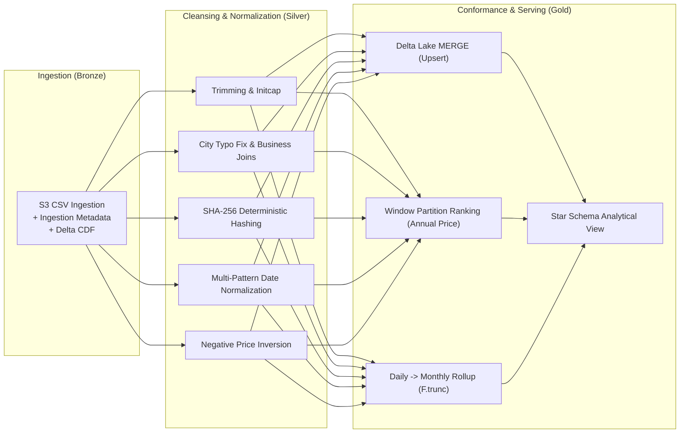
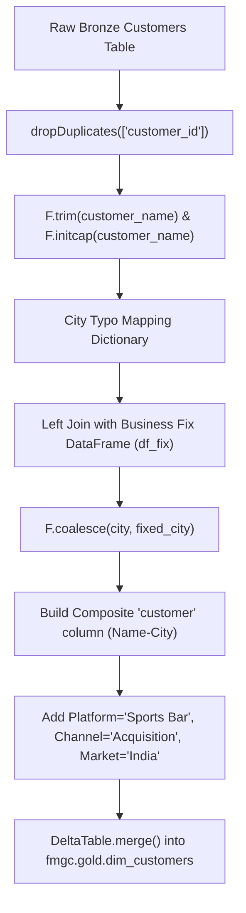
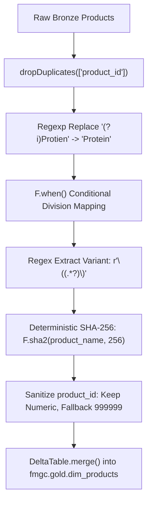
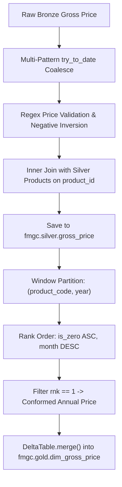
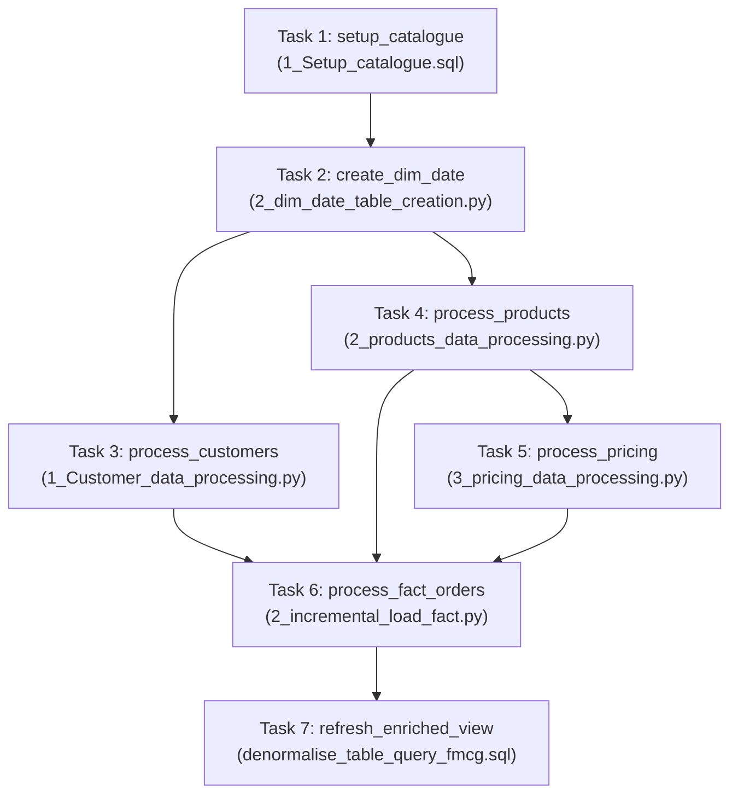

# ⚙️ Pipeline Engineering & ETL Architecture
## End-to-End PySpark, Delta Lake, & Databricks Workflows Implementation

---

### 1. High-Level Pipeline Architecture

The consolidation pipeline processes both **Parent Company (ABC)** and **Child Company (abc)** data assets through a standardized **Medallion Architecture (Bronze $\rightarrow$ Silver $\rightarrow$ Gold)** implemented using PySpark and Delta Lake.



---

### 2. Dimension Data Processing Pipelines

#### 2.1 Customer Dimension Processing (`1_Customer_data_processing.py`)

##### Engineering Challenges Addressed:
1. Deduplication on `customer_id`.
2. Removal of leading/trailing whitespaces and casing standardization (`F.initcap`).
3. Mapping common city spelling mistakes to standard metropolitan centers.
4. Business-rule-driven resolution for null customer cities.
5. Standardizing customer attributes (`market`, `platform`, `channel`, `customer = customer_name-city`) to match the Parent Company (ABC) Star Schema.



##### Key PySpark Transformation Code:
```python
# 1. Deduplication & Trimming
df_silver = df_bronze.dropDuplicates(["customer_id"])
df_silver = df_silver.withColumn("customer_name", F.initcap(F.trim(F.col("customer_name"))))

# 2. Correct City Typos
city_mapping = {
    'Bengaluruu': 'Bengaluru',
    'Bengalore': 'Bengaluru',
    'Hyderabadd': 'Hyderabad',
    'Hyderbad': 'Hyderabad',
    'NewDelhi': 'New Delhi',
    'NewDheli': 'New Delhi',
    'NewDelhee': 'New Delhi'
}
allowed = ["Bengaluru", "Hyderabad", "New Delhi"]

df_silver = (
    df_silver
    .replace(city_mapping, subset=["city"])
    .withColumn(
        "city",
        F.when(F.col("city").isNull(), None)
         .when(F.col("city").isin(allowed), F.col("city"))
         .otherwise(None)
    )
)

# 3. Resolve Missing / Null Cities via Business Lookup Join
customer_city_fix = {
    789403: "New Delhi",  # SprintX Nutrition
    789420: "Bengaluru",  # ZenAthlete Foods
    789521: "Hyderabad",  # PrimeFuel Nutrition
    789603: "Hyderabad"   # Recovery Lane
}

df_fix = spark.createDataFrame(
    [(k, v) for k, v in customer_city_fix.items()],
    ["customer_id", "fixed_city"]
)

df_silver = (
    df_silver
    .join(df_fix, "customer_id", "left")
    .withColumn("city", F.coalesce("city", "fixed_city"))
    .drop("fixed_city")
)

# 4. Standardize Attributes for Parent Company (ABC) Star Schema
df_silver = (
    df_silver
    .withColumn("customer_id", F.col("customer_id").cast("string"))
    .withColumn("customer", F.concat_ws("-", "customer_name", F.coalesce(F.col("city"), F.lit("Unknown"))))
    .withColumn("market", F.lit("India"))
    .withColumn("platform", F.lit("Sports Bar"))
    .withColumn("channel", F.lit("Acquisition"))
)

# 5. Idempotent Delta Lake MERGE into Gold Customer Dimension
delta_table = DeltaTable.forName(spark, "fmgc.gold.dim_customers")
delta_table.alias("target").merge(
    source=df_child_customers.alias("source"),
    condition="target.customer_code = source.customer_code"
).whenMatchedUpdateAll().whenNotMatchedInsertAll().execute()
```

---

#### 2.2 Product Dimension Processing (`2_products_data_processing.py`)

##### Engineering Challenges Addressed:
1. Deduplication on `product_id`.
2. Fixing legacy typos (`Protien` $\rightarrow$ `Protein`).
3. Extracting product variants from parenthesized name tokens (e.g., `(60g)`, `(30 Sachets)`).
4. Mapping granular product categories into parent enterprise divisions (`Nutrition Bars`, `Breakfast Foods`, `Dairy & Recovery`, etc.).
5. Generating deterministic, collision-resistant enterprise surrogate keys using **SHA-256 Hashing**.
6. Sanitizing corrupt alphanumeric product IDs (`XYZ123` $\rightarrow$ `999999`).



##### Key PySpark Transformation Code:
```python
# 1. Spelling Fix & Casing
df_silver = (
    df_bronze
    .dropDuplicates(["product_id"])
    .withColumn("category", F.initcap(F.col("category")))
    .withColumn("product_name", F.regexp_replace(F.col("product_name"), "(?i)Protien", "Protein"))
    .withColumn("category", F.regexp_replace(F.col("category"), "(?i)Protien", "Protein"))
)

# 2. Division Mapping & Variant Extraction
df_silver = (
    df_silver
    .withColumn(
        "division",
        F.when(F.col("category") == "Energy Bars",        "Nutrition Bars")
         .when(F.col("category") == "Protein Bars",       "Nutrition Bars")
         .when(F.col("category") == "Granola & Cereals",  "Breakfast Foods")
         .when(F.col("category") == "Recovery Dairy",     "Dairy & Recovery")
         .when(F.col("category") == "Healthy Snacks",     "Healthy Snacks")
         .when(F.col("category") == "Electrolyte Mix",    "Hydration & Electrolytes")
         .otherwise("Other")
    )
    .withColumn("variant", F.regexp_extract(F.col("product_name"), r"\((.*?)\)", 1))
)

# 3. Deterministic SHA-256 Product Code & Clean Product ID
df_silver = (
    df_silver
    .withColumn("product_code", F.sha2(F.col("product_name").cast("string"), 256))
    .withColumn(
        "product_id",
        F.when(
            F.col("product_id").cast("string").rlike("^[0-9]+$"),
            F.col("product_id").cast("string")
        ).otherwise(F.lit("999999"))
    )
    .withColumnRenamed("product_name", "product")
)

# 4. Upsert into Gold Product Dimension
delta_table = DeltaTable.forName(spark, "fmgc.gold.dim_products")
delta_table.alias("target").merge(
    source=df_child_products.alias("source"),
    condition="target.product_code = source.product_code"
).whenMatchedUpdate(
    set={
        "division": "source.division",
        "category": "source.category",
        "product": "source.product",
        "variant": "source.variant"
    }
).whenNotMatchedInsert(
    values={
        "product_code": "source.product_code",
        "division": "source.division",
        "category": "source.category",
        "product": "source.product",
        "variant": "source.variant"
    }
).execute()
```

---

#### 2.3 Pricing Dimension Processing (`3_pricing_data_processing.py`)

##### Engineering Challenges Addressed:
1. Multi-pattern date parsing across 4 formats (`yyyy/MM/dd`, `dd/MM/yyyy`, `yyyy-MM-dd`, `dd-MM-yyyy`).
2. Validating numeric price strings, inverting negative prices (`-84` $\rightarrow$ `84`), and mapping invalid strings (`unknown`) to `0`.
3. Enriching with `product_code` via inner join on `product_id`.
4. Converting monthly pricing to **annual conformed price** using **Window Partition Ranking** (prioritizing non-zero latest prices).



##### Key PySpark Transformation Code:
```python
# 1. Multi-Format Date Parsing
df_silver = df_bronze.withColumn(
    "month",
    F.coalesce(
        F.try_to_date(F.col("month"), "yyyy/MM/dd"),
        F.try_to_date(F.col("month"), "dd/MM/yyyy"),
        F.try_to_date(F.col("month"), "yyyy-MM-dd"),
        F.try_to_date(F.col("month"), "dd-MM-yyyy")
    )
)

# 2. Validate Price Strings & Invert Negatives
df_silver = df_silver.withColumn(
    "gross_price",
    F.when(F.col("gross_price").rlike(r'^-?\d+(\.\d+)?$'), 
           F.when(F.col("gross_price").cast("double") < 0, -1 * F.col("gross_price").cast("double"))
            .otherwise(F.col("gross_price").cast("double")))
    .otherwise(0.0)
)

# 3. Enrich with product_code from Silver Products
df_products = spark.table("fmgc.silver.products") 
df_joined = df_silver.join(df_products.select("product_id", "product_code"), on="product_id", how="inner")

# 4. Window Ranking to Roll Up Monthly Prices to Annual Enterprise Price
w = (
    Window
    .partitionBy("product_code", "year")
    .orderBy(F.col("is_zero"), F.col("month").desc())
)

df_gold_latest_price = (
    df_gold_price
    .withColumn("year", F.year("month").cast("string"))
    .withColumn("is_zero", F.when(F.col("gross_price") == 0, 1).otherwise(0))
    .withColumn("rnk", F.row_number().over(w))
    .filter(F.col("rnk") == 1)
    .select("product_code", F.col("gross_price").alias("price_inr"), "year")
)

# 5. Upsert into Gold Gross Price Dimension
delta_table = DeltaTable.forName(spark, "fmgc.gold.dim_gross_price")
delta_table.alias("target").merge(
    source=df_gold_latest_price.alias("source"),
    condition="target.product_code = source.product_code AND target.year = source.year"
).whenMatchedUpdate(
    set={"price_inr": "source.price_inr"}
).whenNotMatchedInsert(
    values={"product_code": "source.product_code", "price_inr": "source.price_inr", "year": "source.year"}
).execute()
```

---

### 3. Fact Orders Pipelines: Full Load vs Incremental Load

```mermaid
flowchart TD
    subgraph "Historical Backfill (Full Load)"
        FL1["Read All CSVs from S3 landing/"] --> FL2["Filter Nulls, Clean Dates, Clean IDs"]
        FL2 --> FL3["Join Silver Products -> Attach product_code"]
        FL3 --> FL4["Save to Granular fmgc.gold.sb_fact_orders"]
        FL4 --> FL5["Roll Up: F.trunc('date', 'MM') + sum(sold_quantity)"]
        FL5 --> FL6["Delta MERGE into fmgc.gold.fact_orders"]
        FL6 --> FL7["Archive S3 Files: dbutils.fs.mv(landing, processed)"]
    end

    subgraph "Daily Operational Pipeline (Incremental Load)"
        IL1["Read New CSVs from S3 landing/"] --> IL2["Write to fmgc.bronze.staging_orders"]
        IL2 --> IL3["Archive S3 Files: landing/ -> processed/"]
        IL3 --> IL4["Cleanse & Join Products -> fmgc.silver.staging_orders"]
        IL4 --> IL5["Delta MERGE into Granular fmgc.gold.sb_fact_orders"]
        IL5 --> IL6["Extract Affected Months (incremental_months)"]
        IL6 --> IL7["Recalculate Monthly Aggregates for Impacted Months Only"]
        IL7 --> IL8["Delta MERGE into fmgc.gold.fact_orders"]
        IL8 --> IL9["DROP TABLE staging_orders (Cleanup)"]
    end
```



#### 3.1 Full Load Pipeline (`1_full_load_fact.py`)
1. **Ingestion & S3 Archiving**: Reads all historical landing CSV files, writes to `fmgc.bronze.orders`, and immediately moves processed files to `s3://.../orders/processed/`.
2. **Cleansing**:
   - Filter rows where `order_qty` is not null.
   - Clean `customer_id` (`regex ^[0-9]+$`, fallback `999999`).
   - Strip day-of-week strings via `F.regexp_replace(order_placement_date, r"^[A-Za-z]+,\s*", "")`.
   - Parse multi-format dates using `F.coalesce(try_to_date(...))`.
   - Deduplicate on `(order_id, order_placement_date, customer_id, product_id, order_qty)`.
3. **Granular Persistence**: Saves daily order lines into `fmgc.gold.sb_fact_orders` for operational reporting.
4. **Monthly Rollup & Merge**:
   ```python
   df_monthly = (
       df_child
       .withColumn("month_start", F.trunc("date", "MM"))
       .groupBy("month_start", "product_code", "customer_code")
       .agg(F.sum("sold_quantity").alias("sold_quantity"))
       .withColumnRenamed("month_start", "date")
   )

   gold_parent_delta = DeltaTable.forName(spark, "fmgc.gold.fact_orders")
   gold_parent_delta.alias("parent_gold").merge(
       df_monthly.alias("child_gold"),
       "parent_gold.date = child_gold.date AND parent_gold.product_code = child_gold.product_code AND parent_gold.customer_code = child_gold.customer_code"
   ).whenMatchedUpdateAll().whenNotMatchedInsertAll().execute()
   ```

---

#### 3.2 Incremental Load Pipeline (`2_incremental_load_fact.py`)
1. **Staging Ingestion**: Daily files are ingested into isolated staging tables (`fmgc.bronze.staging_orders` and `fmgc.silver.staging_orders`).
2. **S3 File Archiving**: Move daily files from `landing/` to `processed/`.
3. **Dynamic Month Partition Detection**:
   ```python
   incremental_month_df = (
       df_child
       .select(F.trunc("date", "MM").alias("start_month"))
       .distinct()
   )
   incremental_month_df.createOrReplaceTempView("incremental_months")
   ```
4. **Targeted Monthly Recalculation**: Instead of reprocessing all historical facts, the pipeline queries only the days belonging to the arriving months from `sb_fact_orders`, re-aggregates monthly sums, and applies an idempotent `DeltaTable.merge()` into `fmgc.gold.fact_orders`.
5. **Staging Cleanup**: Drops staging tables upon job completion to maintain storage hygiene.

---

### 4. Databricks Workflows & Job Orchestration



| Task Name | Type | Dependencies | Key Operation |
| :--- | :--- | :--- | :--- |
| `setup_catalogue` | SQL Notebook | *None (Root)* | Ensures `fmgc` catalog and `bronze`, `silver`, `gold` schemas exist. |
| `create_dim_date` | Python Notebook | `setup_catalogue` | Populates calendar surrogate keys and quarter attributes. |
| `process_customers` | Python Notebook | `create_dim_date` | Ingests, repairs cities, standardizes attributes, merges `dim_customers`. |
| `process_products` | Python Notebook | `create_dim_date` | Cleanses typos, extracts variants, hashes SHA-256 `product_code`, merges `dim_products`. |
| `process_pricing` | Python Notebook | `process_products` | Normalizes dates, inverts negative prices, computes annual rollup, merges `dim_gross_price`. |
| `process_fact_orders`| Python Notebook | `process_customers`, `process_products`, `process_pricing` | Ingests daily incremental orders, merges daily fact, recalculates impacted monthly aggregates, merges `fact_orders`. |
| `refresh_enriched_view`| SQL Notebook | `process_fact_orders` | Re-compiles `vw_fact_orders_enriched` for downstream BI and Genie consumption. |
