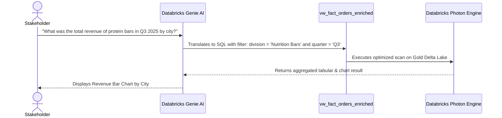

# 📊 Analytics & BI Dashboard Guide
## Semantic Layer Design, KPI Definitions, & Executive BI Walkthrough

---

### 1. Semantic Layer: Unified Gold Analytical View

To provide business analysts, executives, and Databricks Genie AI with a lightning-fast, zero-friction reporting interface, the data model is flattened into an optimized analytical view: **`fmgc.gold.vw_fact_orders_enriched`**.

```mermaid
flowchart TD
    FO["fmgc.gold.fact_orders<br/>(Monthly Base Sales)"] --> V["vw_fact_orders_enriched<br/>(Denormalized Semantic Layer)"]
    DD["fmgc.gold.dim_date<br/>(Calendar Attributes)"] -->|date = month_start_date| V
    DC["fmgc.gold.dim_customers<br/>(Platform, Market, Channel)"] -->|customer_code| V
    DP["fmgc.gold.dim_products<br/>(Division, Category, Variant)"] -->|product_code| V
    GP["fmgc.gold.dim_gross_price<br/>(Annual Gross Price)"] -->|product_code, YEAR(date)| V

    V --> BI1["Executive Overview"]
    V --> BI2["Product Performance"]
    V --> BI3["Customer & Market Analysis"]
    V --> AI["Databricks Genie AI Space"]
```

#### SQL Implementation (`fmgc.gold.vw_fact_orders_enriched`)
```sql
CREATE OR REPLACE VIEW fmgc.gold.vw_fact_orders_enriched AS (
    SELECT 
        fo.date,
        fo.product_code,
        fo.customer_code,

        -- Date attributes
        dd.date_key,
        dd.year,
        dd.month_name,
        dd.month_short_name,
        dd.quarter,
        dd.year_quarter,

        -- Customer attributes
        dc.customer,
        dc.market,
        dc.platform,
        dc.channel,

        -- Product attributes
        dp.division,
        dp.category,
        dp.product,
        dp.variant,

        -- Metrics
        fo.sold_quantity,
        gp.price_inr,

        -- Derived Metric: Total Revenue (INR)
        (fo.sold_quantity * gp.price_inr) AS total_amount_inr
    
    FROM fmgc.gold.fact_orders fo

    -- Join with Date Dimension
    LEFT JOIN fmgc.gold.dim_date dd
           ON fo.date = dd.month_start_date

    -- Join with Customer Dimension
    LEFT JOIN fmgc.gold.dim_customers dc 
           ON fo.customer_code = dc.customer_code

    -- Join with Product Dimension
    LEFT JOIN fmgc.gold.dim_products dp 
           ON fo.product_code = dp.product_code

    -- Join with Price Dimension (Year-based matching)
    LEFT JOIN fmgc.gold.dim_gross_price gp 
           ON fo.product_code = gp.product_code
          AND YEAR(fo.date) = gp.year
);
```

---

### 2. Core Business KPIs & Metric Definitions

| Metric | SQL Formulation | Business Purpose | Target Audience |
| :--- | :--- | :--- | :--- |
| **Gross Revenue (INR)** | `SUM(total_amount_inr)` | Measures overall financial sales output across parent and acquired brands. | C-Suite, VP Sales |
| **Total Units Sold** | `SUM(sold_quantity)` | Tracks supply chain, fulfillment throughput, and physical demand. | Operations, Supply Chain |
| **Average Selling Price (ASP)** | `SUM(total_amount_inr) / SUM(sold_quantity)` | Evaluates pricing power and mix shift between high-margin and low-margin SKUs. | Pricing, Brand Managers |
| **Channel Contribution %** | `SUM(CASE WHEN channel = 'Acquisition' THEN total_amount_inr END) / SUM(total_amount_inr) * 100` | Quantifies the financial synergy impact of the Child Company (abc) acquisition on Parent Company (ABC)'s total top-line. | Corporate Development, M&A |
| **Platform Share** | `SUM(total_amount_inr)` grouped by `platform` (`Sports Bar`, `Brick & Mortar`, `E-Commerce`) | Assesses channel migration and omnichannel customer engagement. | Commercial Strategy |

---

### 3. Executive Dashboard Suite Walkthrough

#### 3.1 Executive Overview Dashboard


- **Total Revenue & Volume High-Level Cards**: Instant visibility into enterprise-wide gross sales and cumulative unit volume.
- **Monthly Revenue Trend**: Displays monthly sales trajectories comparing legacy Parent Company equipment against post-acquisition Child Company nutrition lines.
- **Channel & Platform Contribution**: Visual breakdown highlighting revenue contribution from `Retailer`, `Direct`, and newly integrated `Acquisition` channels.

---

#### 3.2 Product Performance Analysis Dashboard


- **Division-Level Breakdown**: Compares revenue contribution across divisions (`Nutrition Bars`, `Breakfast Foods`, `Dairy & Recovery`, `Hydration & Electrolytes`, `Archery`, `Badminton`, etc.).
- **Top 10 Best-Selling SKUs**: Granular drill-down into top-performing products by both gross sales and unit volume.
- **Variant Analysis**: Evaluates sales velocity by unit sizes (e.g., `45g` vs `65g` Protein Bars, `15 Sachets` vs `30 Sachets` Electrolyte Mix).

---

#### 3.3 Customer & Market Analysis Dashboard


- **Geographic Revenue Distribution**: Visualizes market penetration across major metropolitan clusters (`Bengaluru`, `Hyderabad`, `New Delhi`, etc.).
- **Customer Segmentation**: Ranks top retail partners (e.g., `FitFuel Market`, `Sporty Essentials`, `PowerPlay Sports`, `PrimeFuel Nutrition`).
- **Brick & Mortar vs. Digital Platforms**: Measures performance across retail store networks vs direct platforms.

---

### 4. Self-Service Querying with Databricks Genie AI

With the conformed semantic layer in place, business stakeholders can query enterprise sales data using conversational natural language via **Databricks Genie AI**.



#### Example Prompts Handled by Databricks Genie:
1. *"Show me the month-over-month revenue growth of Child Company products after July 2025."*
2. *"Compare average selling price between Energy Bars and Protein Bars in New Delhi."*
3. *"List the top 5 customers contributing to the Acquisition channel in 2025."*
4. *"Which product variant generated the highest volume in Hyderabad?"*
